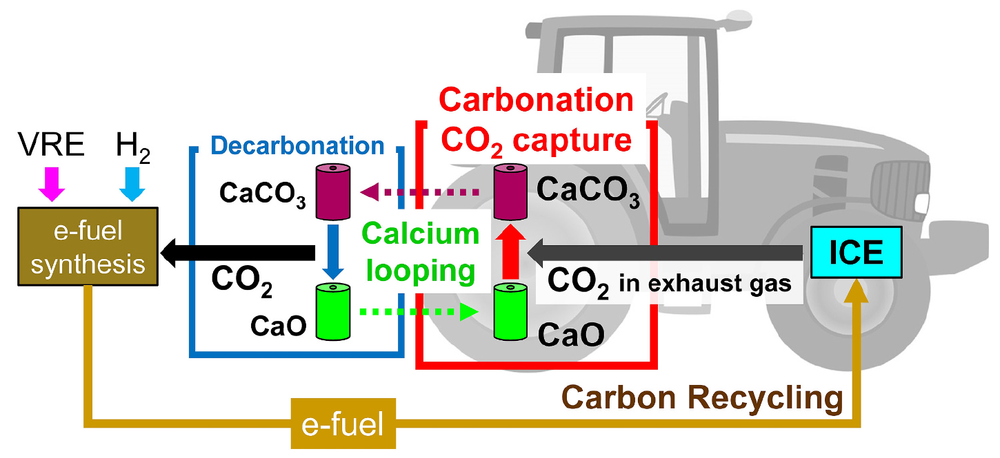
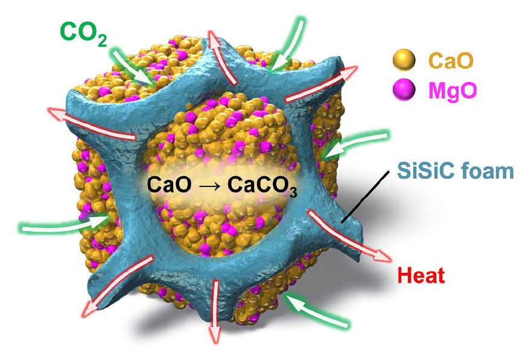
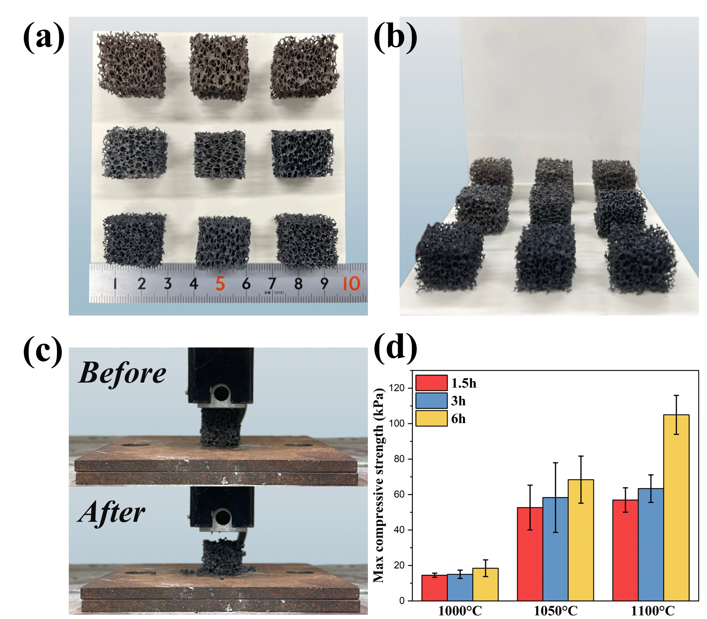
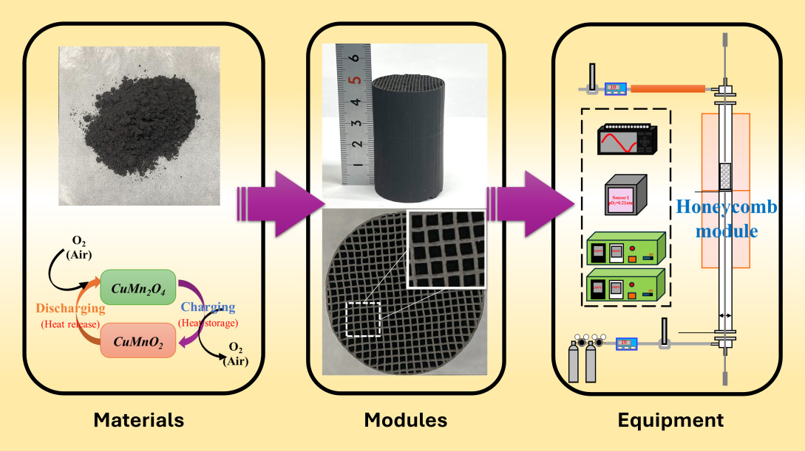

## vACRES: Durable CO2 Capture Materials for Carbon Recycling

  <figure class="project-module-gallery__item">
    <a href="/images/vacres-concept.png" target="_blank" rel="noopener">
      
        
      
    </a>
    <figcaption>vACRES carbon recycling concept (Fig. 1)</figcaption>
  </figure>
  <figure class="project-module-gallery__item">
    <a href="/images/vacres-cao-mgo-sisic.png" target="_blank" rel="noopener">
      
        
      
    </a>
    <figcaption>CaO–MgO/SiSiC composite design (Fig. 2)</figcaption>
  </figure>

Our vACRES research explores e-fuel vehicles with an Active Carbon Recycling System, in which CO2 captured from engine exhaust is recovered through calcium looping and reused with renewable hydrogen to synthesize e-fuels. Toward compact onboard CO2 capture, we developed a composite that combines an MgO-stabilized CaO sorbent with a silicon-infiltrated silicon carbide (SiSiC) foam support. The rigid, thermally conductive foam network helps maintain the sorbent structure and suppress sintering during repeated carbonation and decarbonation.

Laboratory-scale fixed-bed experiments demonstrated stable carbonation conversion of approximately 60% to 56% over cycles 2–30, compared with a decline from 55% to 27% for the reference block without SiSiC foam. The composite showed little bulk volume change after 30 cycles and an effective thermal conductivity of up to 1.1 W m−1 K−1, approximately ten times that of the reference material. These results support the development of durable CO2 capture materials for future vehicle carbon recycling systems.

Figures 1 and 2 from Tomita et al., *Chemical Engineering Journal* **547** (2026), 180712.

[View paper](https://doi.org/10.1016/j.cej.2026.180712)

## CuMn2O4/CuMnO2-Based Thermochemical Energy Storage Modules

  <figure class="project-module-gallery__item">
    <a href="/images/porous-module.jpg" target="_blank" rel="noopener">
      
        
      
    </a>
    <figcaption>Support-free porous foam module</figcaption>
  </figure>
  <figure class="project-module-gallery__item">
    <a href="/images/honeycomb-module.jpg" target="_blank" rel="noopener">
      
        
      
    </a>
    <figcaption>Extruded honeycomb module</figcaption>
  </figure>

Our thermochemical energy storage research explores structured CuMn2O4/CuMnO2 modules that store heat through reduction and release it through reoxidation in air. Toward fixed-bed storage systems, we developed two complementary designs: a support-free porous foam fabricated using a polyurethane foam replica method, and a honeycomb module prepared by extrusion molding. These open structures provide gas-flow pathways, while module design and preparation must balance heat and mass transfer, mechanical strength, and redox reactivity.

For the porous foam, optimization of sintering conditions identified 1100 °C for 6 h as the preferred preparation condition, and the modules retained their integrity after 50 redox cycles. Laboratory-scale heat-release experiments with the honeycomb module demonstrated a maximum outlet-temperature increase of 46.2 ± 4.1 °C and a thermal output power of 4.97 ± 0.49 W (97.99 ± 9.59 W/kg) under the optimal tested conditions. A maximum conversion ratio of 0.863 ± 0.007 was also achieved. These studies connect material development with structured module design for medium- to high-temperature thermochemical energy storage.

Related studies: Chen et al., *Chemical Engineering Journal* **485** (2024), 149540; and *ACS Sustainable Chemistry & Engineering* (2025).

[Porous foam module paper](https://doi.org/10.1016/j.cej.2024.149540) · [Honeycomb module paper](https://doi.org/10.1021/acssuschemeng.4c10715)
