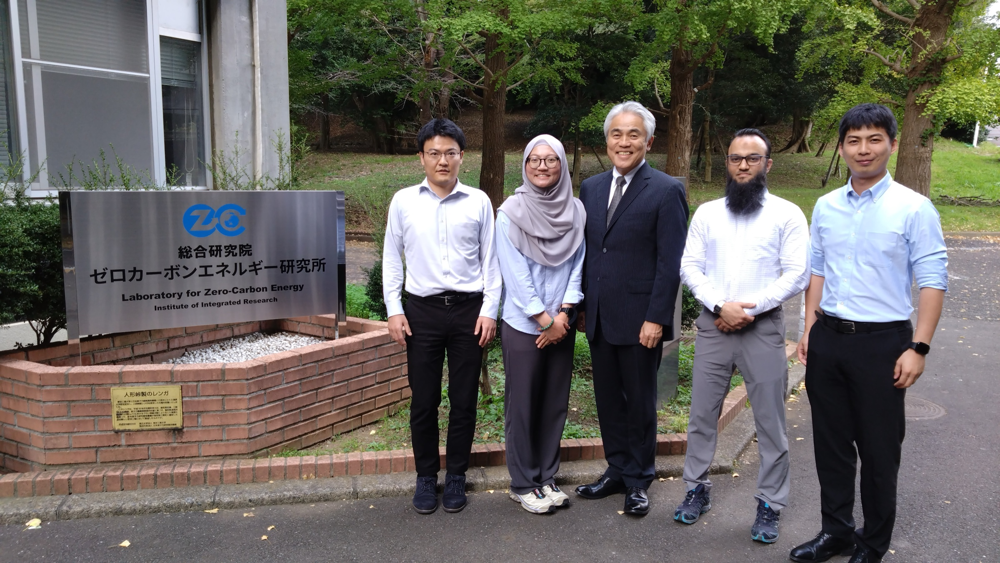

On October 15, 2026, Dr.-Ing. Mohammed Liaket Ali from the German Aerospace Center (DLR) visited the Laboratory for Zero-Carbon Energy at Institute of Science Tokyo. We exchanged ideas on thermochemical energy storage (TCES) and CO2 capture technologies.

